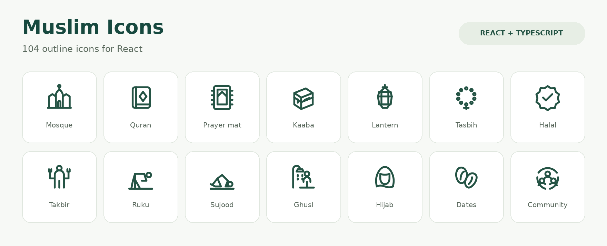

<p align="center">
  
</p>

# Muslim Icons for React

**104 outline icons. Seven categories. Ready for your next project.**

Building a prayer app, a Quran reader, or a website for your local mosque? Muslim Icons gives you a set of symbols for the things your community uses every day.

Each icon is a React component, drawn on a 24 × 24 grid with rounded strokes. Change the size, color, or stroke weight to fit your interface.

[Website](https://muslimicons.vercel.app) · [Quick start](#quick-start) · [Categories](#categories) · [Customize](#customize-your-icons) · [All icons](#all-104-icons) · [GitHub](https://github.com/kolapoimam/muslim-icons)

Using another framework? See [Vue 3](https://github.com/kolapoimam/muslim-icons/tree/main/packages/vue), [Svelte 5](https://github.com/kolapoimam/muslim-icons/tree/main/packages/svelte), or [raw SVG](https://github.com/kolapoimam/muslim-icons/tree/main/packages/svg). These packages share the same artwork and component names.

## At a glance

| | Included |
| --- | --- |
| Collection | **104 distinct icons** across **7 categories** |
| React | React **18 and 19** |
| TypeScript | Built-in declarations and an exported `IconProps` type |
| Imports | Named exports, ESM, and CommonJS |
| Styling | SVG props, CSS, and utility classes |
| Accessibility | Decorative by default; supports accessible labels |
| Design | 24 × 24 viewBox, 2-unit stroke, rounded caps and joins |

## Quick start

Install the package in a React project:

```bash
npm install @muslim-icons/react
```

Import the icons you need and use them like any other component:

```tsx
import { Mosque, Quran, PrayerMat } from '@muslim-icons/react';

export function ResourceLinks() {
  return (
    <nav aria-label="Explore resources">
      <a href="/mosques"><Mosque size={20} /> Find a mosque</a>
      <a href="/quran"><Quran size={20} /> Read the Quran</a>
      <a href="/prayer"><PrayerMat size={20} /> Prayer guide</a>
    </nav>
  );
}
```

Use named imports so your bundler can keep the icons your app needs. The package supports tree shaking and works with React projects built with Vite, Next.js, and other compatible tools.

## Categories

Choose a category to see the full list of component names below. Counts come from the source SVG collection; each icon is counted once.

| Category | What you'll find | Icons |
| --- | --- | ---: |
| [Worship & Prayer](#worship--prayer) | Prayer positions, prayer times, Qibla, dhikr beads, and purification. | **18** |
| [Quran & Knowledge](#quran--knowledge) | Books, recitation, study, memorisation, and learning. | **13** |
| [Ramadan & Eid](#ramadan--eid) | Fasting, meals, dates, lanterns, gifts, and Eid celebrations. | **11** |
| [Hajj & Umrah](#hajj--umrah) | The Kaaba, pilgrimage rites, landmarks, and travel on foot. | **11** |
| [Places & Architecture](#places--architecture) | Mosques, domes, minarets, prayer halls, and entrances. | **11** |
| [Muslim Lifestyle](#muslim-lifestyle) | Family, community, clothing, food, Halal, Haram, and everyday life. | **26** |
| [General Islamic Concepts](#general-islamic-concepts) | Charity, patience, gratitude, remembrance, and other shared ideas. | **14** |
| **Total** | **Seven categories** | **104** |

## Prayer, purification, and everyday choices

If you're building a prayer guide, these component names are a good place to start:

| Part of prayer | Component | Visual |
| --- | --- | --- |
| Opening takbir | `Takbir` | Hands raised beside the head |
| Standing | `Qiyam` | Standing with folded arms |
| Bowing | `Ruku` | A bowed posture |
| Standing after bowing | `Qawmah` | Upright with arms lowered |
| Prostration | `Sujood` | A prostrating posture |
| Sitting between prostrations | `Jalsah` | A seated posture |
| Seated testimony | `Tashahhud` | Seated with a raised index finger |
| Closing greeting | `Taslim` | Seated with the head turned |

For purification, use `Wudu`, `Ghusl`, or `Tayammum`. For permitted or prohibited status, use `HalalBadge` and `Haram`. `HalalFood` and `HalalShopping` are available for more specific contexts.

```tsx
import { Ghusl, HalalBadge, Haram } from '@muslim-icons/react';

export function TopicLabels() {
  return (
    <ul>
      <li><Ghusl /> Ghusl</li>
      <li><HalalBadge /> Halal</li>
      <li><Haram /> Haram</li>
    </ul>
  );
}
```

## Customize your icons

Every icon accepts the same props, along with standard React SVG properties such as `className`, `style`, `onClick`, and `aria-label`. SVG refs are forwarded to the underlying element.

| Prop | Type | Default | What it does |
| --- | --- | --- | --- |
| `size` | `number` or `string` | `24` | Sets both width and height |
| `color` | `string` | `currentColor` | Sets the stroke color |
| `strokeWidth` | `number` or `string` | `2` | Sets the stroke weight |
| `absoluteStrokeWidth` | `boolean` | `false` | With a numeric pixel size, keeps the stroke thickness steady as the icon scales |

### Size, color, and stroke

```tsx
import { Mosque, Quran, Kaaba } from '@muslim-icons/react';

export function IconStyles() {
  return (
    <div>
      <Mosque size={32} color="#246b55" strokeWidth={1.5} />
      <Quran size="2rem" />
      <Kaaba size={48} strokeWidth={2} absoluteStrokeWidth />
    </div>
  );
}
```

### CSS and utility classes

Icons inherit the surrounding text color through `currentColor`:

```tsx
import { PrayerMat } from '@muslim-icons/react';

export function PrayerLabel() {
  return <span style={{ color: '#246b55' }}><PrayerMat /> Prayer</span>;
}
```

You can also pass a CSS class. For example, in a project using Tailwind CSS:

```tsx
import { Mihrab } from '@muslim-icons/react';

export function PrayerSpaceIcon() {
  return <Mihrab size={24} className="text-emerald-700" />;
}
```

### TypeScript

Use `IconProps` when your own component accepts icon options:

```tsx
import { Mosque, type IconProps } from '@muslim-icons/react';

export function MosqueIcon(props: IconProps) {
  return <Mosque size={20} {...props} />;
}
```

## Accessibility

Icons beside visible text are decorative by default, so screen readers skip them. When an icon carries meaning on its own, give it a label:

```tsx
import { PrayerTime, QiblaCompass } from '@muslim-icons/react';

export function PrayerTools() {
  return (
    <div>
      <PrayerTime aria-label="Prayer time" />
      <button type="button" aria-label="Find the Qibla">
        <QiblaCompass />
      </button>
    </div>
  );
}
```

For an icon-only button, put the accessible name on the button. A labeled icon automatically receives `role="img"`; `aria-labelledby` is supported too.

## All 104 icons

Open a category to find its exact export names. You can also [browse the SVG source](https://github.com/kolapoimam/muslim-icons/tree/main/packages/core/icons).

### Worship & Prayer

<details>
<summary>Show all 18 icons</summary>

`Adhan`, `DuaHands`, `Ghusl`, `Jalsah`, `PrayerCap`, `PrayerMat`, `PrayerTime`, `Qawmah`, `QiblaCompass`, `Qiyam`, `Ruku`, `Sujood`, `Takbir`, `Tasbih`, `Tashahhud`, `Taslim`, `Tayammum`, `Wudu`.

</details>

### Quran & Knowledge

<details>
<summary>Show all 13 icons</summary>

`ArabicLetter`, `BookRehal`, `Bookmark`, `DuaBook`, `Graduation`, `HadithBook`, `IslamicBook`, `Knowledge`, `Memorisation`, `OpenQuran`, `QuranStand`, `Quran`, `Reading`.

</details>

### Ramadan & Eid

<details>
<summary>Show all 11 icons</summary>

`CrescentMoon`, `Dates`, `EidGift`, `EidMoon`, `Eid`, `Fasting`, `Iftar`, `RamadanLantern`, `Ramadan`, `Suhoor`, `Zakat`.

</details>

### Hajj & Umrah

<details>
<summary>Show all 11 icons</summary>

`Arafat`, `Hajj`, `Ihram`, `Jamarat`, `Kaaba`, `Mina`, `Pilgrimage`, `SafaMarwah`, `Tawaf`, `Umrah`, `ZamzamWater`.

</details>

### Places & Architecture

<details>
<summary>Show all 11 icons</summary>

`IslamicCentre`, `MadinahDome`, `MakkahSign`, `Mihrab`, `Minaret`, `Minbar`, `MosqueDome`, `MosqueEntrance`, `Mosque`, `PrayerHall`, `StarAndCrescent`.

</details>

### Muslim Lifestyle

<details>
<summary>Show all 26 icons</summary>

`Abaya`, `Announcement`, `Children`, `Community`, `Donation`, `Family`, `Food`, `HalalBadge`, `HalalFood`, `HalalShopping`, `Haram`, `Hijab`, `Home`, `Imam`, `IslamicSchool`, `Kufi`, `Marriage`, `ModestFashion`, `MosqueCommunity`, `MuslimGroup`, `Thobe`, `Travel`, `Volunteer`, `Water`, `Wedding`, `WomenCommunity`.

</details>

### General Islamic Concepts

<details>
<summary>Show all 14 icons</summary>

`Afterlife`, `Charity`, `Dhikr`, `Dua`, `GoodDeeds`, `Gratitude`, `Guidance`, `IslamicCalendar`, `IslamicFinance`, `Mercy`, `Peace`, `Sabr`, `Sadaqah`, `Tawakkul`.

</details>

## Help shape the collection

Missing an icon you'd use? [Open an icon request](https://github.com/kolapoimam/muslim-icons/issues/new) and tell us what it should represent and where you'd use it. A short description or a rough sketch is welcome.

Found a drawing that could be clearer? We'd like to hear about that too. If you'd like to contribute, start with the [contribution guide](https://github.com/kolapoimam/muslim-icons/blob/main/CONTRIBUTING.md).

## License

The React package code is [MIT licensed](https://github.com/kolapoimam/muslim-icons/blob/main/packages/react/LICENSE).

Original SVG artwork has a [separate license notice](https://github.com/kolapoimam/muslim-icons/blob/main/packages/core/LICENSE), describing an intended CC0 1.0 dedication subject to confirmation of contributor rights.

---

Made and maintained by [Kolapo Imam](https://github.com/kolapoimam). If you build something with these icons, we'd love to see it.
